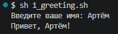
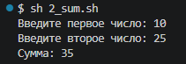
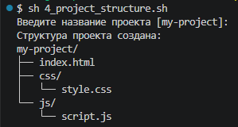
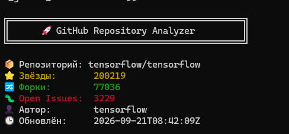

# Учебный репозиторий

<p align="center">
  
  
  
  
</p>

Здесь собраны учебные материалы и практические работы по командной строке, Bash, Git, Markdown и Mermaid. Репозиторий помогает хранить конспекты в одном месте и быстро переходить от теории к примерам.


> **Как пользоваться:** выбери тему в навигации ниже. В документах есть команды, примеры кода, пояснения и результаты выполнения практических заданий.

---

## Навигация

| Раздел | Что внутри |
|---|---|
| [Практика Bash](./bash-practicals/README.md) | 8 скриптов: ввод данных, вычисления, условия, работа с файлами и GitHub API |
| [Конспект Bash](./Bash.md) | Команды терминала, файловые операции, сведения о Linux, сети и запуске программ |
| [Основы Linux и Bash](./Linux/Bash/README.md) | Краткая шпаргалка по работе в терминале и файловой системе |
| [Основы Git](./git.md) | Зачем нужен Git, версии проекта и основные принципы работы |
| [Markdown](./markdown.md) | Синтаксис Markdown: оформление текста, списки, ссылки, изображения и таблицы |
| [Mermaid](./mermaid.md) | Диаграммы и схемы прямо в Markdown-документах |
| [Редактирование текста](./Text.md) | Клавиши и сочетания для перемещения, выделения, поиска и редактирования текста |
| [Тема Markdown и README](./README.md) | Эта страница: обзор структуры репозитория и быстрый доступ к материалам |
| [Тестовый Сайт](https://notsons-git.github.io/my-site/) | Одностраничный сайт по мотивам противостояния Патрика Джейна и Красного Джона |
| [Сайт-визитка пиццерии «Печь & Искра»](https://github.com/notsons-git/my-web-site)¹ | Многостраничный сайт на HTML, CSS и JavaScript: меню, поиск, фильтры и демонстрационная корзина |

¹ Репозиторий с исходным кодом сайта: [notsons-git/my-web-site](https://github.com/notsons-git/my-web-site).

---

## Практическая работа по Bash

В папке **[bash-practicals](./bash-practicals/)** находятся восемь небольших скриптов. Они показывают, как получать ввод пользователя, выполнять простые вычисления, проверять условия, создавать структуру проекта, искать файлы и получать данные через GitHub API.

### Примеры результатов

<table>
  <tr>
    <td align="center" width="50%">
              <a href="https://github.com/notsons-git/test/blob/main/bash-practicals/img/1.png">
        
      </a>
      <sub><b>01 · Приветствие пользователя</b></sub>
    </td>
    <td align="center" width="50%">
              <a href="https://github.com/notsons-git/test/blob/main/bash-practicals/img/2.png">
        
      </a>
      <sub><b>02 · Сложение двух чисел</b></sub>
    </td>
  </tr>
  <tr>
    <td align="center" width="50%">
              <a href="https://github.com/notsons-git/test/blob/main/bash-practicals/img/4.png">
        
      </a>
      <sub><b>04 · Создание структуры проекта</b></sub>
    </td>
    <td align="center" width="50%">
              <a href="https://github.com/notsons-git/test/blob/main/bash-practicals/img/8.png">
        
      </a>
      <sub><b>08 · Анализ репозитория GitHub</b></sub>
    </td>
  </tr>
</table>

**Все задания, описания и скриншоты:** [открыть отчёт по практической работе](./bash-practicals/README.md).

---

## Структура проекта

```text
test/
├── README.md                 # Обзор репозитория и навигация
├── Bash.md                   # Конспект по Bash и терминалу
├── Text.md                   # Горячие клавиши для редактирования текста
├── git.md                    # Конспект по Git
├── markdown.md               # Синтаксис Markdown
├── mermaid.md                # Диаграммы Mermaid
├── Linux/
│   └── Bash/
│       └── README.md         # Краткая шпаргалка по Linux/Bash
├── bash-practicals/
│   ├── README.md             # Отчёт по 8 практическим заданиям
│   ├── .gitignore            # Исключения для Git
│   ├── scripts/              # Исходный код Bash-скриптов
│   │   ├── 1_greeting.sh
│   │   ├── 2_sum.sh
│   │   ├── 3_even.sh
│   │   ├── 4_project_structure.sh
│   │   ├── 5_line_count.sh
│   │   ├── 6_password.sh
│   │   ├── 7_find_files.sh
│   │   └── 8_github_stats.sh
│   └── img/                  # Скриншоты результатов заданий
│       ├── 1.png … 8.png
├── src/README.md             # Заготовка раздела src
├── translations/README.md    # Заготовка раздела переводов
└── resources/README.md       # Заготовка раздела ресурсов
```

---

## Краткое описание файлов

### Конспекты

| Файл | Описание |
|---|---|
| [Bash.md](./Bash.md) | Команды терминала, файловые операции, сведения о системе, сети и запуске программ |
| [Linux/Bash/README.md](./Linux/Bash/README.md) | Краткая шпаргалка по Linux и Bash |
| [git.md](./git.md) | Основы контроля версий и работа с Git |
| [markdown.md](./markdown.md) | Синтаксис Markdown для оформления документации |
| [mermaid.md](./mermaid.md) | Блок-схемы, диаграммы последовательности, классов и Ганта |
| [Text.md](./Text.md) | Сочетания клавиш для перемещения, выделения, поиска и редактирования текста |

### Практика Bash

| Файл | Назначение |
|---|---|
| [bash-practicals/README.md](./bash-practicals/README.md) | Отчёт по заданиям с примерами и скриншотами |
| [1_greeting.sh](./bash-practicals/scripts/1_greeting.sh) | Запрос имени и вывод приветствия |
| [2_sum.sh](./bash-practicals/scripts/2_sum.sh) | Ввод двух чисел и вычисление суммы |
| [3_even.sh](./bash-practicals/scripts/3_even.sh) | Проверка числа на чётность |
| [4_project_structure.sh](./bash-practicals/scripts/4_project_structure.sh) | Создание структуры веб-проекта |
| [5_line_count.sh](./bash-practicals/scripts/5_line_count.sh) | Подсчёт строк в файле |
| [6_password.sh](./bash-practicals/scripts/6_password.sh) | Генерация случайного пароля |
| [7_find_files.sh](./bash-practicals/scripts/7_find_files.sh) | Поиск файлов по расширению |
| [8_github_stats.sh](./bash-practicals/scripts/8_github_stats.sh) | Получение статистики публичного репозитория через GitHub API |
| [img/](./bash-practicals/img/) | Скриншоты результатов восьми заданий |
| [.gitignore](./bash-practicals/.gitignore) | Файлы и папки, которые Git должен игнорировать |

### Служебные заготовки

| Файл | Описание |
|---|---|
| [src/README.md](./src/README.md) | Заготовка документации для исходных файлов |
| [translations/README.md](./translations/README.md) | Заготовка раздела переводов |
| [resources/README.md](./resources/README.md) | Заготовка раздела ресурсов |

---

## Как открыть проект

1. Склонируй репозиторий или скачай его архив.
2. Открой папку проекта в Visual Studio Code или другом редакторе.
3. Выбери нужный конспект в навигации выше.
4. Чтобы посмотреть практику и результаты выполнения, открой [отчёт Bash](./bash-practicals/README.md).

Для запуска Bash-скриптов потребуется Bash-совместимая среда, например Linux, WSL или Git Bash. Скрипт № 8 дополнительно обращается к публичному GitHub API.

---

<p align="center">
  <sub>Учебные материалы · Конспекты · Практика · Документация</sub>
</p>
